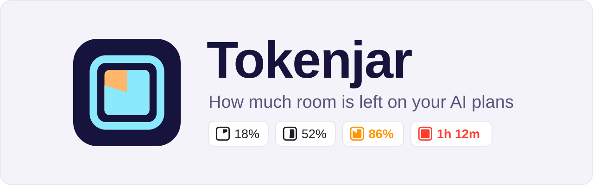
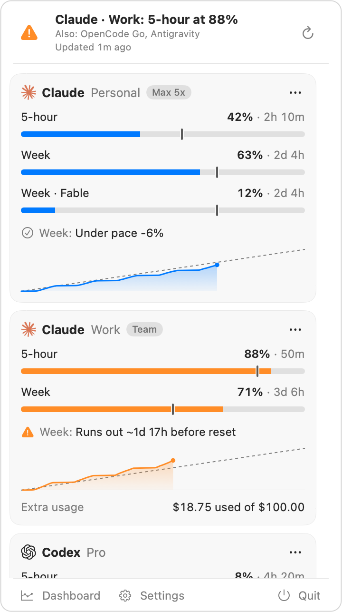
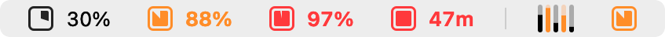
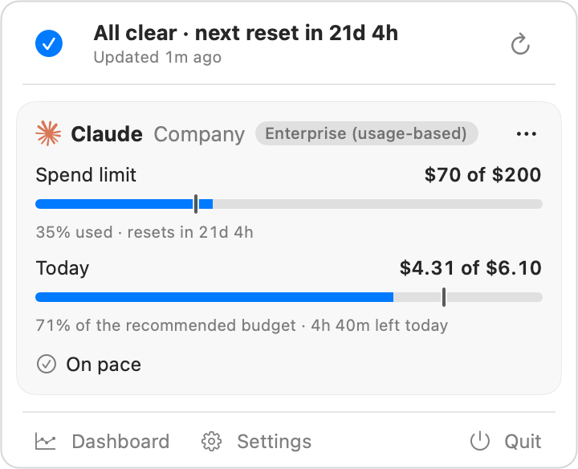
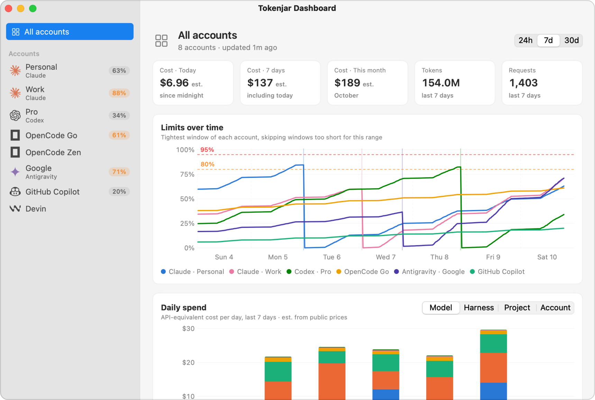
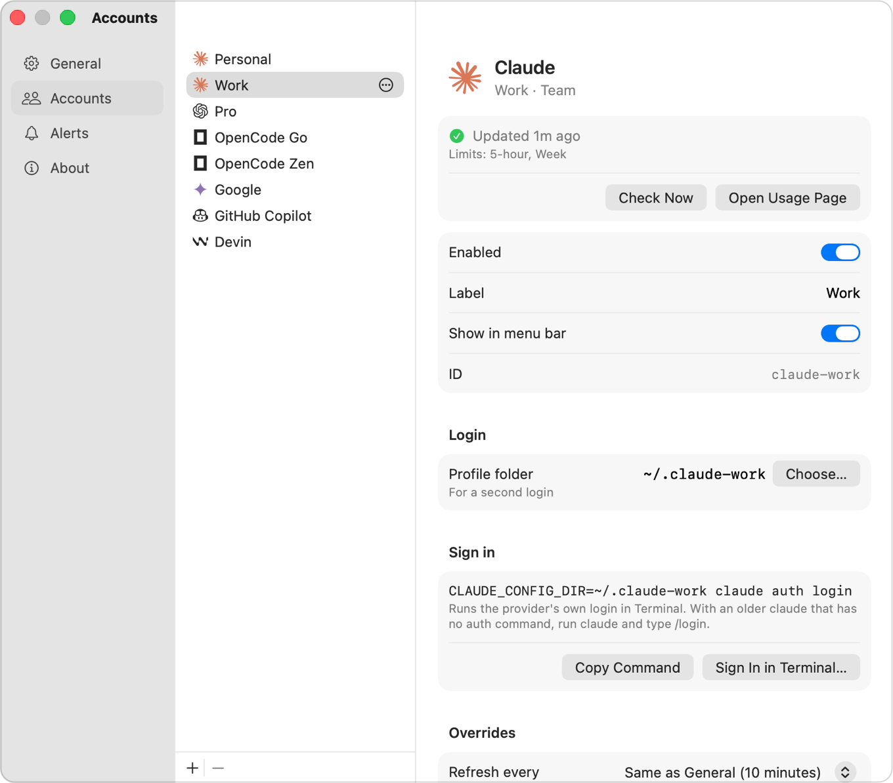

<picture>
  <source media="(prefers-color-scheme: dark)" srcset="docs/images/banner-dark.svg">
  
</picture>

[](https://github.com/PedroMosquera/tokenjar/actions/workflows/ci.yml)

Tokenjar is a macOS menu bar app that shows how much of each AI plan's usage limit you have left, and whether you will hit it before it resets. It covers Claude, Codex, OpenCode Go and Zen, Antigravity and GitHub Copilot. Devin shares no usage yet, so it only gets a link to its usage page in Settings.

I built it because I did not want a third-party app handling my AI logins. Tokenjar asks each provider's own CLI for the numbers, except for OpenCode, where it reads opencode's key and local database. History stays on your Mac. There is no prebuilt download: you build it from source with the Command Line Tools, by hand or through Homebrew.

<p align="center">
  <picture>
    <source media="(prefers-color-scheme: dark)" srcset="docs/images/popover-dark.png">
    
  </picture>
</p>

## What it tracks

| Provider | Where the numbers come from | Plans it recognizes |
|---|---|---|
| Claude | `claude -p /usage`, with hooks and MCP servers off | Pro, Max, Max 5x, Max 20x, Team, Team Premium, Enterprise. An Enterprise seat billed per use has no plan limits, so it shows its monthly spend limit instead. API key, gateway (such as LiteLLM), Bedrock, Vertex and Foundry logins have no plan limits, so their card shows this month's and today's spend instead, estimated at list price from the local logs, and where the month is headed at that rate. Tokenjar finds them in Claude's `settings.json`, not in your shell. |
| Codex | `codex app-server`, read-only | Free, Go, Plus, Pro, Business, Edu, Enterprise |
| OpenCode Go | One HTTPS GET to opencode.ai with your opencode key | Go |
| OpenCode Zen | This month's spend, added up from the local `opencode.db` | Pay as you go |
| Antigravity | `agy -p /usage` (agy 1.1.11 or later) | No plan name. Each quota pool agy reports becomes a limit. |
| GitHub Copilot | `gh api`, a read-only GET | Free, Pro, Pro+, Max, Business, Enterprise |
| Devin, which now includes Windsurf | Nothing yet. Devin shares no usage with local apps, so it has no card; its page in Settings opens the usage page. | |

The Antigravity reader has never run against a live install. Copilot's endpoint is undocumented, and most Copilot plans have not been checked against a real account.

## Using it

The menu bar item shows the used percent of the account with the least room left, or of the account you pinned with Pin to Menu Bar in a card's ⋯ menu; the pin is kept for that Mac only, and the right-click menu can unpin it. By default it turns red at 95% and amber at 80%, or sooner when a window that is at least half used is on pace to run out before it resets. When a window is full it counts down to the reset instead. A slash across the icon means Tokenjar can't refresh right now, because the Mac is offline or no provider answered. Faded numbers are out of date, and a dot means something needs you: a failed check you can fix, or settings that can't be read. Devin and OpenCode Zen never show up there. An account billed per use counts by its spend limit, like any other limit. Settings > General changes both levels, can switch the item to one thin bar per account or to the icon alone, and can show the amount spent instead of the percent for an account billed per use. That amount is off by default, since anyone near your screen can read it.

<p align="center">
  <picture>
    <source media="(prefers-color-scheme: dark)" srcset="docs/images/menubar-dark.png">
    
  </picture>
</p>

Clicking it opens the popover shown at the top. Each limit window gets a bar with a tick where an even pace would be, and the time until it resets. The line under the bars says how you are tracking, such as "Under pace -6%" or "Runs out ~1d 17h before reset". A failed check says what went wrong and offers the fix. When a limit is full, the header also names the account with the most room left, such as "Codex has room: 5-hour 2% used". When the Mac is offline or no provider answers, the header says so once and the cards keep their last numbers with their age. Command-R refreshes, and a click outside the popover or Escape closes it. The cards follow the order of the accounts in Settings; Settings > General can group them by provider or put the account with the least room left on top. An account that can't connect, because its CLI is missing or it has never been signed in, stays out of the popover until it does. One that worked and then signed out keeps its card, since that needs you. Hide and Stop Checking in a card's ⋯ menu turns an account off, and the footer counts what is hidden ("2 hidden"); clicking it opens Settings, where Enabled turns an account back on.

An Enterprise seat billed per use has one limit, the money it may spend this month. Its card shows that spend limit in money, such as "$70 of $200", with the share used and the time until it resets on the 1st, at midnight UTC, under the bar. Spending past the limit is allowed on these seats, so past 100% the card, the header and the menu bar keep counting ("108%", "$240 over") instead of calling it full, and you get one notification when spend first passes the limit. Claude's `/usage` does not report that date, so it comes from the calendar month. Turn on Daily budget on the account's page in Settings to add a Today bar: today's spend against what you can spend per day and still end the month under the limit. Type an amount to use a fixed budget instead. The bar keeps counting past 100% to show how far over today is, and you get one notification a day when it goes over. Claude reports only the month's total, so Tokenjar works out today from its own checks: the total now minus the total at its last check before midnight.

<p align="center">
  <picture>
    <source media="(prefers-color-scheme: dark)" srcset="docs/images/popover-spend-limit-dark.png">
    
  </picture>
</p>

Right-click the menu bar item, or Control-click it, for Refresh Now, Open Dashboard, Settings and Quit Tokenjar. Quitting from that menu, the popover or Command-Q asks first. Hold Option in the menu to quit without being asked.

The dashboard (Command-D) charts each limit over time with its resets and estimates what your usage would have cost at API prices, split by model, harness, project or account. For a seat billed per use it charts instead what was actually spent each hour, day or week, worked out from its spend limit at each of Tokenjar's checks, with the daily budget as a dashed line. Charts start where Tokenjar's history does, so a new install fills in over the first days. Antigravity and Copilot keep no local logs, so they show limits only.

<p align="center">
  <picture>
    <source media="(prefers-color-scheme: dark)" srcset="docs/images/dashboard-dark.png">
    
  </picture>
</p>

Each account gets its own page in Settings with its status, the fix when a check fails, and buttons to check it now or sign in from Terminal. Adding an account asks for its name first. Drag accounts in the list to reorder them, or use the ⋯ button on a row, also on right-click, to rename, hide from the menu bar, move or remove one.

<p align="center">
  <picture>
    <source media="(prefers-color-scheme: dark)" srcset="docs/images/settings-account-dark.png">
    
  </picture>
</p>

Alerts are local notifications. By default you get one when a window crosses 80% or 95%, when the pace says you will run out before the reset, when a source stops working, and, with a daily budget on, the first time a day goes over it. Settings > Alerts changes the levels and has a reset alert, which is off by default. Until you click Allow Banners there, alerts go to Notification Center without a banner.

### In scripts

`Tokenjar --status` prints each enabled account's last numbers as one line of JSON: its plan, when it was checked, whether that is out of date, and each limit window with its used percent, reset time, where an even pace would be and whether it runs out before the reset. It runs no check and writes nothing, so a tmux, SketchyBar or Claude Code status line can call it every few seconds while the app keeps the numbers fresh. `version` changes only when a field changes meaning or goes away.

```sh
alias tokenjar=~/Applications/Tokenjar.app/Contents/MacOS/Tokenjar
tokenjar --status | jq -r '.accounts[] | .label as $label | .tightestWindowID as $t | .windows[] | select(.id == $t) | "\($label) \(.usedPercent | round)%"'
```

That prints one line per account with the number the menu bar uses, such as `Personal 81%`.

## Privacy

Tokenjar never reads or refreshes an OAuth token; each CLI keeps and renews its own login. The app's own requests are `GET https://opencode.ai/zen/go/v1/usage` and, only if you turn on Check provider status pages in Settings on that Mac, one GET to the public status page of each of Claude, Codex and GitHub Copilot you track, when you open the popover or refresh. A test fails if another endpoint is added. The Copilot request is gh's own, with gh's telemetry turned off. Tokenjar itself has no telemetry and no update check, and it never imports browser cookies.

On disk it keeps token counts, model ids, timestamps and project folder names, plus each account's plan name, limit percentages and reset times. Log paths and response ids are stored only as SHA-256 digests. Prompts, outputs, emails and provider account ids are never stored. Settings > About lists what the app runs, reads, contacts and writes, and [docs/privacy.md](docs/privacy.md) has the full list.

## Requirements

- macOS 14 or later.
- Command Line Tools with Swift 6.2 or later (`xcode-select --install`). Xcode is not needed.
- For the Homebrew install, macOS 15.6 or later (Homebrew checks only for macOS 15).
- The CLI for each provider you track: `claude`, `codex`, `agy` 1.1.11 or later, and `gh` signed in with `gh auth login`. OpenCode and Devin need none.

## Install

Both ways below build Tokenjar from source on your Mac with the Command Line Tools, sign it ad-hoc there and end with the app in `~/Applications`. Neither needs admin rights, though installing Homebrew itself does if you do not have it yet. Pick one and stay with it, so that only one copy runs.

### With Homebrew

```sh
brew install PedroMosquera/tap/tokenjar
tokenjar-install-app
```

The full name adds the [PedroMosquera/homebrew-tap](https://github.com/PedroMosquera/homebrew-tap) tap and trusts only this formula. Homebrew downloads the tagged source, builds it with network access turned off (a minute or a few, depending on the Mac), and keeps `Tokenjar.app` in its own folder. Homebrew does not put apps in `~/Applications`, so `tokenjar-install-app` then does what `make install` does with its own build: it quits the Tokenjar running from `~/Applications`, copies Homebrew's build there and opens it. `tokenjar-install-app <folder>` puts it somewhere else.

To update, run `brew upgrade tokenjar`, then `tokenjar-install-app` again. Until you do, the previous version keeps running. Homebrew reminds you after each install and upgrade. If you used `make install` before, run `make clean` in that clone or delete it, so macOS does not pick that build over this one. If that was `make install INSTALL_DIR=<folder>`, give `tokenjar-install-app` the same folder, so it replaces that copy. Homebrew's own install analytics include the formula's name; `brew analytics off` turns them off ([docs/privacy.md](docs/privacy.md#traffic-that-is-not-tokenjars)).

### With make

```sh
git clone https://github.com/PedroMosquera/tokenjar.git
cd tokenjar
make install
```

That builds a release binary, wraps it in `Tokenjar.app`, signs it ad-hoc, copies it to `~/Applications` and opens it. It shows no Gatekeeper prompt. `make install INSTALL_DIR=<folder>` puts it somewhere else.

To update, pull and run `make install` again. It quits the Tokenjar running from the install folder, replaces it and opens the new build. A copy started anywhere else, such as by `make run` or a `.build` binary, keeps running.

### After installing

Tokenjar has no Dock icon, except while the dashboard or Settings is open. Launch at login stays off until you turn it on in Settings > General; turn it on from the copy in `~/Applications`. If you pasted an API key in Settings, macOS asks once more for Keychain access after each update, because every build gets a new ad-hoc signature.

### Removing it

Turn off Launch at login, quit Tokenjar and delete `~/Applications/Tokenjar.app`. If you installed with Homebrew, also run `brew uninstall tokenjar`, which removes Homebrew's copy and the `tokenjar-install-app` command. If you use nothing else from that tap, `brew untap PedroMosquera/tap` removes the tap too, so `brew update` stops fetching it.

To clear its data as well, delete `~/Library/Application Support/Tokenjar` (history), run `defaults delete com.pedromosquera.tokenjar` (window sizes and positions), and remove any "Tokenjar API key" item in Keychain Access. Delete settings with `rm -r ~/.config/tokenjar` (or `$XDG_CONFIG_HOME/tokenjar` if Tokenjar runs with that variable set), typed out with no trailing slash, which tab completion can add. If that folder or its `config.json` is a link into a dotfiles repository, this removes only the link. If the folder that holds it, such as `~/.config`, is itself a link into a repository, this deletes the `tokenjar` folder inside that repository. [docs/privacy.md](docs/privacy.md#what-it-writes) lists everything Tokenjar writes. These steps have not been tested on a clean Mac.

## First run

If there is no config file yet, Tokenjar writes one with default settings and the accounts it finds: Claude Code in `~/.claude`, a Codex login, opencode's API keys (Zen stays off the menu bar), `agy` and `gh` if they are installed, and a Devin or Windsurf install. It looks for `gh` but does not run it. If you used CodexBar, Settings > General > Import from CodexBar shows what would change before it changes anything.

## Configuration

Settings writes everything to `~/.config/tokenjar/config.json`, and you can edit it by hand too: the app picks up changes within 30 seconds. Two Claude logins look like this:

```json
{
  "accounts": [
    { "id": "claude", "provider": "claude", "label": "Personal" },
    { "id": "claude-work", "provider": "claude", "label": "Work", "profileDir": "~/.claude-work" }
  ]
}
```

Pick an `id` once and keep it. History and alerts are stored under it.

The file holds no secrets, only where keys live, so it can sit in a dotfiles repo and be symlinked into place on each Mac (`stow --no-folding` works). Anything that should differ on one Mac, such as a label, goes in `config.local.json` next to it. History, alert state and pasted keys stay on each Mac. [docs/configuration.md](docs/configuration.md) has every field and the details of the shared setup.

## Troubleshooting

"Can't find the claude command on this Mac" (or codex, agy, gh): Tokenjar does not read your shell's `PATH`. It searches a fixed list of folders, and the account's page in Settings shows which ones. If the CLI lives somewhere else, put its full path under `cliPaths` in the config. A Claude Code installed with npm under a Node version manager such as fnm or nvm is in none of those folders; `claude install` switches it to Anthropic's native build in `~/.local/bin`, which Tokenjar finds.

"Signed out" while Claude Code works in your terminal: an API key, a gateway such as LiteLLM or a cloud provider exported only in your shell is invisible to Tokenjar. Put those variables in the `env` block of `~/.claude/settings.json` ([docs/troubleshooting.md](docs/troubleshooting.md#claude-says-signed-out-but-claude-code-works-in-your-terminal) has an example).

No notifications: alerts only come from the installed app, not from `swift run` or a `.build` binary.

[docs/troubleshooting.md](docs/troubleshooting.md) covers sign-in, Copilot access, proxies, paused checks, a broken config file, the Keychain prompt, Macs that only run approved software, and a Homebrew build that stops on older developer tools.

## Development

```sh
make build   # debug build
make test    # Swift Testing; run it with XDG_CONFIG_HOME unset
make app     # release build, bundled and signed as build/Tokenjar.app
```

`.build/debug/Tokenjar --render-snapshots <dir>` and `--render-windows <dir>` draw the app to PNG from built-in preview data, without putting a window on screen. The screenshots in this README come from those two flags, so the accounts, numbers and dates in them are made up. [docs/development.md](docs/development.md) has the other targets and flags, and [docs/design.md](docs/design.md) is the full design.

## License

Tokenjar is under the [MIT License](LICENSE). The provider logos in the app and in these screenshots belong to their owners; [docs/logos.md](docs/logos.md) says where each came from. The logos and a few test fixtures keep their own licenses, listed in [THIRD_PARTY_NOTICES.md](THIRD_PARTY_NOTICES.md). Tokenjar is not affiliated with or endorsed by Anthropic, OpenAI, Google, GitHub, OpenCode, Cognition, Windsurf or CodexBar.
