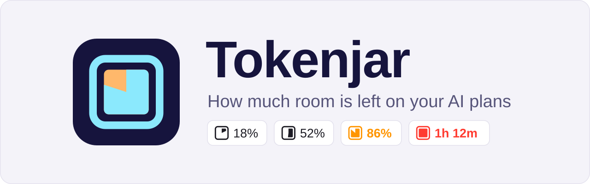
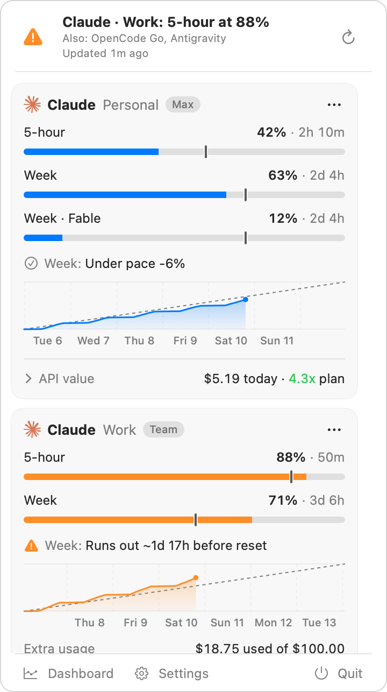
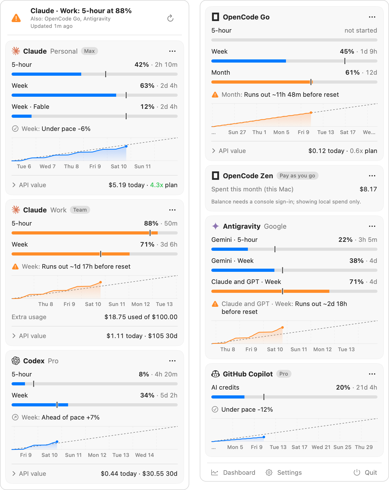
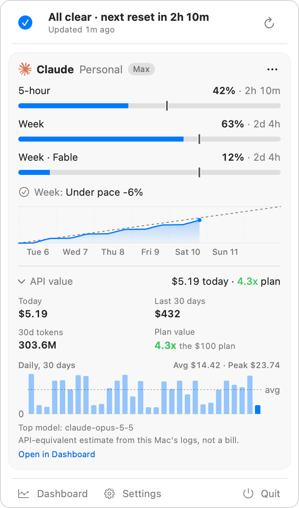
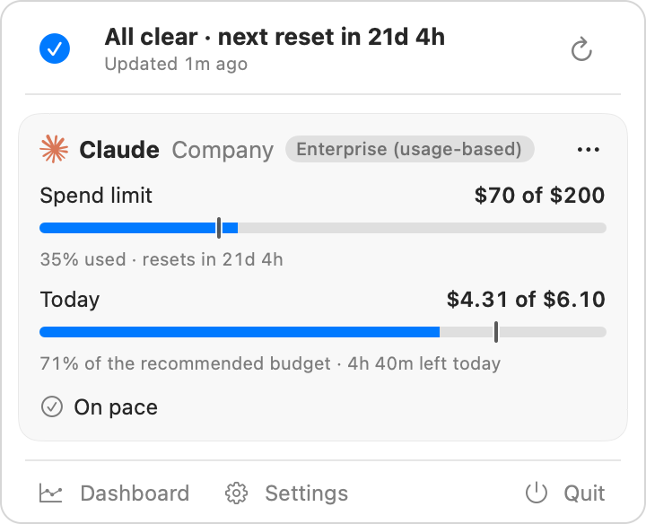
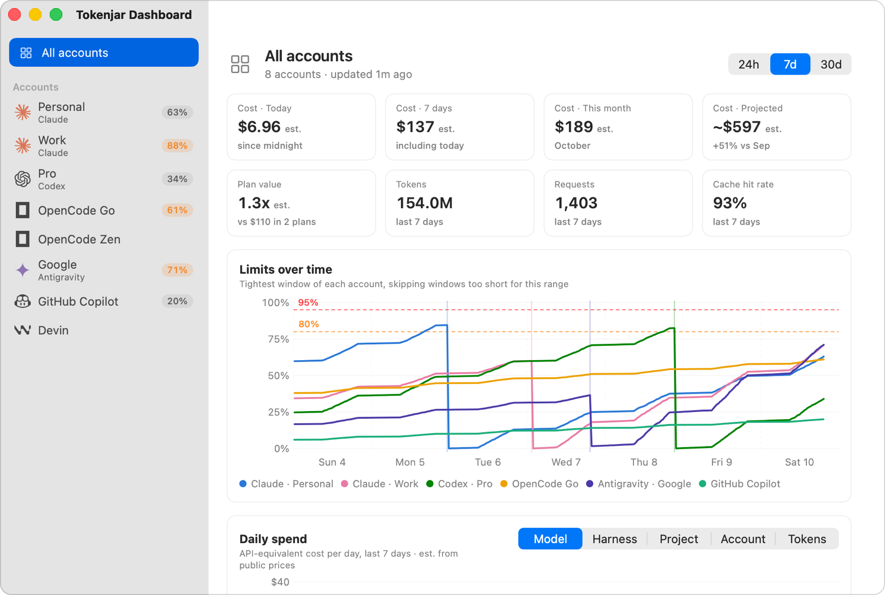
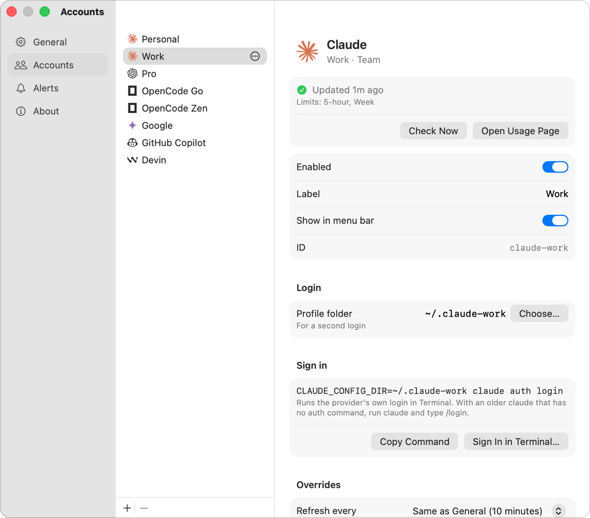

<picture>
  <source media="(prefers-color-scheme: dark)" srcset="docs/images/banner-dark.svg">
  
</picture>

[](https://github.com/PedroMosquera/tokenjar/actions/workflows/ci.yml)

Tokenjar is a macOS menu bar app that shows how much of each AI plan's usage limit you have left, and whether you will hit it before it resets. It covers Claude, Codex, OpenCode Go and Zen, Antigravity and GitHub Copilot.

I built it because I did not want a third-party app handling my AI logins. Tokenjar asks each provider's own CLI for the numbers, except for OpenCode, where it reads opencode's key and local database. History stays on your Mac. There is no prebuilt download: you build it from source with the Command Line Tools, by hand or through Homebrew.

<p align="center">
  <picture>
    <source media="(prefers-color-scheme: dark)" srcset="docs/images/popover-dark.png">
    
  </picture>
</p>

## Highlights

- **Every limit at a glance.** One card per account, a bar per limit window, and the time until each resets.
- **Pace, not just percent.** Each card says whether you will run out before the reset, such as "Runs out ~1d 17h before reset".
- **Is the plan paying for itself?** An API value row prices your usage at API list rates and compares it with the plan, such as "4.3x plan".
- **Spend limits.** Seats billed per use show money spent against the monthly limit, with an optional daily budget.
- **A dashboard** with limits over time, API-equivalent cost by model, project or account, and a 12-month activity calendar.
- **Private by design.** No telemetry, no OAuth tokens read, no third-party service holding your logins.

## Supported providers

| Provider | Where the numbers come from | Plans it recognizes |
|---|---|---|
| Claude | `claude -p /usage`, with hooks and MCP servers off | Pro, Max, Ultra, Team, Team Premium, Enterprise, and logins without plan limits (API key, gateway, Bedrock, Vertex, Foundry) |
| Codex | `codex app-server`, read-only | Free, Go, Plus, Pro, Business, Edu, Enterprise |
| OpenCode Go | One HTTPS GET to opencode.ai with your opencode key | Go |
| OpenCode Zen | This month's spend, added up from the local `opencode.db` | Pay as you go |
| Antigravity | `agy -p /usage` (agy 1.1.11 or later) | No plan name. Each quota pool agy reports becomes a limit. |
| GitHub Copilot | `gh api`, a read-only GET | Free, Pro, Pro+, Max, Business, Enterprise |

Devin (which now includes Windsurf) and Cursor share no usage with local apps, so they have no card. Their page in Settings opens the provider's usage page.

The Antigravity reader has never run against a live install. Copilot's endpoint is undocumented, and most Copilot plans have not been checked against a real account.

## A quick tour

The screenshots use made-up preview data. [docs/usage.md](docs/usage.md) explains every part in detail.

### Menu bar

The menu bar item shows the used percent of the account with the least room left, or of the one you pin. It turns amber at 80% and red at 95%, sooner when a window is on pace to run out, and counts down to the reset once a window is full. Right-click it for Refresh Now, the dashboard, Settings and Quit.

<p align="center">
  <picture>
    <source media="(prefers-color-scheme: dark)" srcset="docs/images/menubar-dark.png">
    
  </picture>
</p>

### Popover

Click the menu bar item for one card per account. Each limit window has a bar, with a tick where an even pace would be, and the line under the bars says how you are tracking. When a limit is full, the header names the account with the most room left.

<details>
<summary>See a card for every supported provider</summary>
<br>
<p align="center">
  <picture>
    <source media="(prefers-color-scheme: dark)" srcset="docs/images/popover-providers-dark.png">
    
  </picture>
</p>
</details>

### API value

On a plan card, the API value row shows what today's usage would cost at API list prices, and how many times the plan's price the last 30 days came to. Click the row to open the last 30 days, the tokens used and a daily chart; click it again to close it. It is an estimate from this Mac's logs, not a bill. Costs show in your region's currency, converted at the European Central Bank's daily rate.

<p align="center">
  <picture>
    <source media="(prefers-color-scheme: dark)" srcset="docs/images/popover-api-value-dark.png">
    
  </picture>
</p>

### Spend limits

An Enterprise seat billed per use has one limit: the money it may spend this month, such as "$70 of $200". Turn on Daily budget in Settings to add a Today bar with what you can spend per day and still end the month under the limit.

<p align="center">
  <picture>
    <source media="(prefers-color-scheme: dark)" srcset="docs/images/popover-spend-limit-dark.png">
    
  </picture>
</p>

### Dashboard

The dashboard (Command-D) charts each limit over time and estimates what your usage would have cost at API prices, split by model, harness, project or account. It adds a month-end projection, the plan value, the cache hit rate and a 12-month activity calendar.

<p align="center">
  <picture>
    <source media="(prefers-color-scheme: dark)" srcset="docs/images/dashboard-dark.png">
    
  </picture>
</p>

### Settings

Each account has its own page with its status, the fix when a check fails, and buttons to check it now or sign in from Terminal. Drag accounts to reorder them. Alerts are local notifications at 80% and 95%, when the pace says you will run out, and when a source stops working.

<p align="center">
  <picture>
    <source media="(prefers-color-scheme: dark)" srcset="docs/images/settings-account-dark.png">
    
  </picture>
</p>

### In scripts

`Tokenjar --status` prints each account's last numbers as one line of JSON, without running a check, so a tmux, SketchyBar or Claude Code status line can call it every few seconds. [docs/usage.md](docs/usage.md#in-scripts) has an example.

## Privacy

Tokenjar never reads or refreshes an OAuth token: each CLI keeps and renews its own login. It has no telemetry and no update check, and it never imports browser cookies.

The app sends only these requests itself, and a test fails if another endpoint is added:

- `GET https://opencode.ai/zen/go/v1/usage`, for OpenCode Go.
- One GET to the public status page of each of Claude, Codex and GitHub Copilot you track, when you open the popover or refresh. Only if you turn on Check provider status pages in Settings on that Mac.
- One GET for the European Central Bank's daily exchange rates, only while this Mac's display currency is not USD. It is the only request to a host that is not a provider, and it sends no account data.

The Copilot request is gh's own, with gh's telemetry turned off.

On disk it keeps token counts, model ids, timestamps and project folder names, plus each account's plan name, limit percentages and reset times. Log paths and response ids are stored only as SHA-256 digests. Prompts, outputs, emails and provider account ids are never stored. Settings > About lists what the app runs, reads, contacts and writes, and [docs/privacy.md](docs/privacy.md) has the full list.

## Requirements

- macOS 14 or later.
- Command Line Tools with Swift 6.2 or later (`xcode-select --install`). Xcode is not needed.
- For the Homebrew install, macOS 15.6 or later (Homebrew checks only for macOS 15).
- The CLI for each provider you track: `claude`, `codex`, `agy` 1.1.11 or later, and `gh` signed in with `gh auth login`. OpenCode, Devin and Cursor need none.

## Install

Both ways below build Tokenjar from source on your Mac with the Command Line Tools, sign it ad-hoc there and end with the app in `~/Applications`. Neither needs admin rights, though installing Homebrew itself does if you do not have it yet. Pick one and stay with it, so that only one copy runs.

### With Homebrew

```sh
brew install PedroMosquera/tap/tokenjar
tokenjar-install-app
```

The full name adds the [PedroMosquera/homebrew-tap](https://github.com/PedroMosquera/homebrew-tap) tap and trusts only this formula. Homebrew downloads the tagged source, builds it with network access turned off (a minute or a few, depending on the Mac), and keeps `Tokenjar.app` in its own folder. Homebrew does not put apps in `~/Applications`, so `tokenjar-install-app` then does what `make install` does with its own build: it quits the Tokenjar running from `~/Applications`, copies Homebrew's build there and opens it. `tokenjar-install-app <folder>` puts it somewhere else.

To update, run `brew upgrade tokenjar`, then `tokenjar-install-app` again. Until you do, the previous version keeps running. Homebrew reminds you after each install and upgrade. If you used `make install` before, run `make clean` in that clone or delete it, so macOS does not pick that build over this one. If that was `make install INSTALL_DIR=<folder>`, give `tokenjar-install-app` the same folder, so it replaces that copy. Homebrew's own install analytics include the formula's name; `brew analytics off` turns them off ([docs/privacy.md](docs/privacy.md#traffic-that-is-not-tokenjars)).

### With make

```sh
git clone https://github.com/PedroMosquera/tokenjar.git
cd tokenjar
make install
```

That builds a release binary, wraps it in `Tokenjar.app`, signs it ad-hoc, copies it to `~/Applications` and opens it. It shows no Gatekeeper prompt. `make install INSTALL_DIR=<folder>` puts it somewhere else.

To update, pull and run `make install` again. It quits the Tokenjar running from the install folder, replaces it and opens the new build. A copy started anywhere else, such as by `make run` or a `.build` binary, keeps running.

### After installing

Tokenjar has no Dock icon, except while the dashboard or Settings is open. Launch at login stays off until you turn it on in Settings > General; turn it on from the copy in `~/Applications`. If you pasted an API key in Settings, macOS asks once more for Keychain access after each update, because every build gets a new ad-hoc signature.

### Removing it

Turn off Launch at login, quit Tokenjar and delete `~/Applications/Tokenjar.app`. If you installed with Homebrew, also run `brew uninstall tokenjar`, which removes Homebrew's copy and the `tokenjar-install-app` command. If you use nothing else from that tap, `brew untap PedroMosquera/tap` removes the tap too, so `brew update` stops fetching it.

To clear its data as well, delete `~/Library/Application Support/Tokenjar` (history), run `defaults delete com.pedromosquera.tokenjar` (window sizes and positions), and remove any "Tokenjar API key" item in Keychain Access. Delete settings with `rm -r ~/.config/tokenjar` (or `$XDG_CONFIG_HOME/tokenjar` if Tokenjar runs with that variable set), typed out with no trailing slash, which tab completion can add. If that folder or its `config.json` is a link into a dotfiles repository, this removes only the link. If the folder that holds it, such as `~/.config`, is itself a link into a repository, this deletes the `tokenjar` folder inside that repository. [docs/privacy.md](docs/privacy.md#what-it-writes) lists everything Tokenjar writes. These steps have not been tested on a clean Mac.

## First run

If there is no config file yet, Tokenjar writes one with default settings and the accounts it finds: Claude Code in `~/.claude`, a Codex login, opencode's API keys (Zen stays off the menu bar), `agy` and `gh` if they are installed, and a Devin, Windsurf or Cursor install. It looks for `gh` but does not run it. If you used CodexBar, Settings > General > Import from CodexBar shows what would change before it changes anything.

## Configuration

Settings writes everything to `~/.config/tokenjar/config.json`, and you can edit it by hand too: the app picks up changes within 30 seconds. Two Claude logins look like this:

```json
{
  "accounts": [
    { "id": "claude", "provider": "claude", "label": "Personal" },
    { "id": "claude-work", "provider": "claude", "label": "Work", "profileDir": "~/.claude-work" }
  ]
}
```

Pick an `id` once and keep it. History and alerts are stored under it.

The file holds no secrets, only where keys live, so it can sit in a dotfiles repo and be symlinked into place on each Mac (`stow --no-folding` works). Anything that should differ on one Mac, such as a label, goes in `config.local.json` next to it. History, alert state and pasted keys stay on each Mac. Update Tokenjar on every Mac before adding a Cursor account to a shared file: an older build cannot load a config that names a provider it does not know. [docs/configuration.md](docs/configuration.md) has every field and the details of the shared setup.

## Troubleshooting

"Can't find the claude command on this Mac" (or codex, agy, gh): Tokenjar does not read your shell's `PATH`. It searches a fixed list of folders, and the account's page in Settings shows which ones. If the CLI lives somewhere else, put its full path under `cliPaths` in the config. A Claude Code installed with npm under a Node version manager such as fnm or nvm is in none of those folders; `claude install` switches it to Anthropic's native build in `~/.local/bin`, which Tokenjar finds.

"Signed out" while Claude Code works in your terminal: an API key, a gateway such as LiteLLM or a cloud provider exported only in your shell is invisible to Tokenjar. Put those variables in the `env` block of `~/.claude/settings.json` ([docs/troubleshooting.md](docs/troubleshooting.md#claude-says-signed-out-but-claude-code-works-in-your-terminal) has an example).

No notifications: alerts only come from the installed app, not from `swift run` or a `.build` binary.

[docs/troubleshooting.md](docs/troubleshooting.md) covers sign-in, Copilot access, proxies, paused checks, a broken config file, the Keychain prompt, Macs that only run approved software, and a Homebrew build that stops on older developer tools.

## Development

```sh
make build          # debug build
make test           # Swift Testing; run it with XDG_CONFIG_HOME unset
make app            # release build, bundled and signed as build/Tokenjar.app
make readme-images  # redraw the screenshots in docs/images from preview data
```

`.build/debug/Tokenjar --render-snapshots <dir>` and `--render-windows <dir>` draw the app to PNG from built-in preview data, without putting a window on screen. The screenshots in this README come from those two flags through `make readme-images`, so the accounts, numbers and dates in them are made up. [docs/development.md](docs/development.md) has the other targets and flags, and [docs/design.md](docs/design.md) is the full design.

## Documentation

- [docs/usage.md](docs/usage.md): how each part of the app behaves.
- [docs/configuration.md](docs/configuration.md): every field of `config.json`, plan prices and the shared setup across Macs.
- [docs/troubleshooting.md](docs/troubleshooting.md): sign-in, CLIs that can't be found, proxies and other fixes.
- [docs/privacy.md](docs/privacy.md): everything Tokenjar runs, reads, contacts and writes.
- [docs/development.md](docs/development.md): building, developer flags, the README images and releasing.
- [docs/design.md](docs/design.md): the design of record.

## License

Tokenjar is under the [MIT License](LICENSE). The provider logos in the app and in these screenshots belong to their owners; [docs/logos.md](docs/logos.md) says where each came from. The logos and a few test fixtures keep their own licenses, listed in [THIRD_PARTY_NOTICES.md](THIRD_PARTY_NOTICES.md). Tokenjar is not affiliated with or endorsed by Anthropic, OpenAI, Google, GitHub, OpenCode, Cognition, Windsurf or CodexBar.
